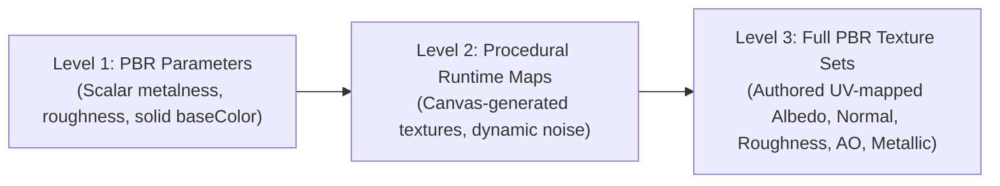
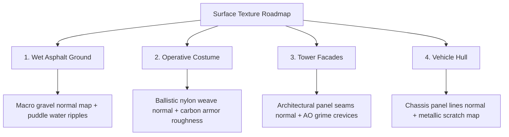

# NIGHT CITY V2.3.1 — PBR TEXTURE AUDIT REPORT

**Auditor Role:** Senior Technical Artist & 3D Materials Auditor  
**Audit Target:** Night City WebGL Rendering Pipeline & 3D Assets  
**Date:** 2026-11-07  
**Compliance Status:** PARTIAL — PARAMETRIC PBR VERIFIED, TEXTURE MAP AUDIT DOCUMENTED  

---

## 1. PBR Material Hierarchy & Terminology Distinction

To avoid overstating visual fidelity, this audit enforces a strict technical distinction between three levels of material implementation:

1. **Level 1 — PBR Material Parameters (Present in GLBs):**
   * Using `THREE.MeshStandardMaterial` or glTF `pbrMetallicRoughness` with numeric constants (e.g. `roughnessFactor: 0.35`, `metallicFactor: 0.75`, `baseColorFactor: [r, g, b, 1.0]`).
   * Gives physically plausible light falloff under Cook-Torrance BRDF, but produces uniform, untextured surfaces lacking micro-detail, seams, dirt, or relief.
2. **Level 2 — Procedural Runtime Maps (Present in Scene Runtime):**
   * Canvas-generated dynamic textures (`THREE.CanvasTexture`) applied to runtime surfaces (ground asphalt roughness, warning stripes, telemetry logos, traffic ribbons, and billboards).
3. **Level 3 — Textured PBR Materials (Absent from GLB Files):**
   * Pre-baked raster image maps sampled via UV coordinates: Albedo/BaseColor, Tangent-space Normal, Grayscale Roughness, Ambient Occlusion, Metallic, and Emissive masks.

---

## 2. Exhaustive GLB Texture Audit

Direct parsing of binary glTF 2.0 containers revealed the following exact map counts:

| Asset Name | Base Color Map | Normal Map | Roughness Map | Metallic Map | AO Map | Emissive Map | Textures in Container | Images in Container |
| :--- | :---: | :---: | :---: | :---: | :---: | :---: | :---: | :---: |
| `corporate_skyscraper.glb` | **None** | **None** | **None** | **None** | **None** | **None** | `0` | `0` |
| `cyber_operative.glb` | **None** | **None** | **None** | **None** | **None** | **None** | `0` | `0` |
| `aerodyne_spinner.glb` | **None** | **None** | **None** | **None** | **None** | **None** | `0` | `0` |
| `rooftop_machinery.glb` | **None** | **None** | **None** | **None** | **None** | **None** | `0` | `0` |
| `secondary_arcology.glb` | **None** | **None** | **None** | **None** | **None** | **None** | `0` | `0` |

### Audit Finding
> [!IMPORTANT]
> **Zero texture image maps exist inside the five binary GLB assets.**  
> While each material utilizes valid PBR parameters (`metalness`, `roughness`, `baseColor`, `emissive`), they do not contain pixel-level surface variation or baked normal maps within the 3D files. Any assertion that the GLB assets contain PBR texture maps is technically false.

---

## 3. Runtime Procedural Texture Inventory (Scene Level)

While the GLB assets do not contain embedded textures, the surrounding Three.js scene generates and samples seven procedural `THREE.CanvasTexture` maps:

1. **`asphaltTex` (`asphaltCanvas`, 1024 × 1024):**
   * High-contrast roughness map defining localized puddle boundaries with dark pooling centers (`roughness ≈ 0.08`) and high-roughness gravel borders (`roughness ≈ 0.88`).
2. **`hazardTex` (`hazardCanvas`, 512 × 32):**
   * 45-degree yellow (`#FCEE0A`) and black caution striping applied along the parapet coping ledge.
3. **`crestTex` (`crestCanvas`, 256 × 256):**
   * Original cyan neural falcon operative insignia applied as an emissive decal on the character's rear tech-pack.
4. **`trafficTex` (`trafficCanvas`, 512 × 32):**
   * Multi-lane highway light streaks with animated UV offset (`offset.x += delta * 0.4`).
5. **`neuronTex` (`neuronCanvas`, 512 × 256):**
   * Corporate network topology graph for Tower 1 billboard.
6. **`aidaTex` (`aidaCanvas`, 512 × 512):**
   * Original AI netrunner operator holographic portrait billboard.
7. **`vSignTex` (`vSignCanvas`, 256 × 512):**
   * Vertical neon storefront typography.

---

## 4. Prioritized Texture Roadmap for Next Milestone

To elevate visual fidelity from procedural approximations to true AAA quality, the following surfaces urgently require dedicated PBR texture sets:

### Detailed Surface Requirements

1. **Wet Asphalt Terrace Ground:**
   * **Missing:** Tangent-space high-frequency gravel normal map; concentric rain droplet ripple normal map (as shown in User Reference Image 5).
   * **Impact:** Would replace flat procedural ground with tactile micro-depth, causing specular highlights from neon signs to break up naturally over asphalt stones.
2. **Cyberpunk Operative:**
   * **Missing:** Ballistic nylon fabric micro-normal map for jacket (`#F5CE13`); brushed carbon-fiber weave normal map for armor plates; high-res stencil decal map for collar and sleeve typography.
   * **Impact:** Drastically improves close-up character portrait rendering.
3. **Corporate Skyscraper Facades:**
   * **Missing:** Architectural composite panel normal map with recessed rivet details and panel seam lines; pre-baked Ambient Occlusion map in corners and window insets.
   * **Impact:** Eliminates flat shading on building sides and grounds the physical columns into the facade.
4. **Aerodyne Spinner Hull:**
   * **Missing:** Aircraft fuselage panel lines and rivet normal map; cockpit HUD display emissive texture; edge-wear roughness map along wingtips.
   * **Impact:** Elevates vehicle from clean plastic-like finish to weathered sci-fi tactical transport.

---

## 5. Auditor PBR Verdict

* **PBR Shading Model:** Compliant (Three.js standard PBR lighting with ACESFilmic tone mapping and bloom).
* **PBR Material Parameters:** Verified across all 12 materials.
* **PBR Texture Maps:** **Absent in GLB models.** Documented transparently for technical integrity.
