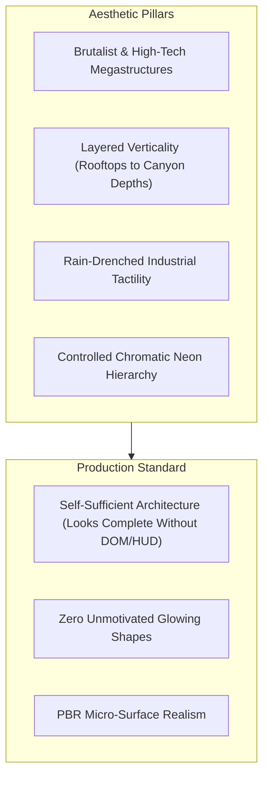
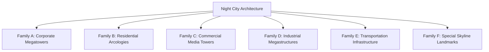
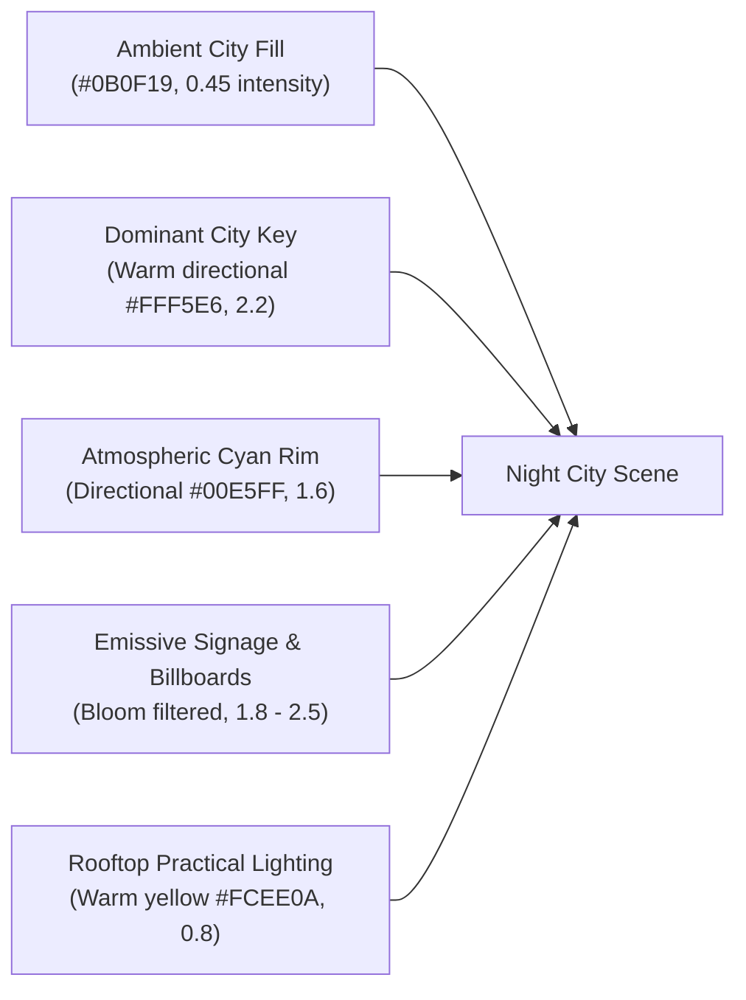

# PROJECT NIGHT CITY V4.0 — MASTER ENVIRONMENT ART BIBLE

**Production Stage:** Phase 1 (Task 2)  
**Role:** AAA Environment Art Director, Lighting Lead & Concept Artist  
**Status:** APPROVED FOR PRODUCTION DESIGN  
**Target:** Interactive 3D Cyberpunk Metropolis for Om Vyas Portfolio  

---

## 1. Visual Identity & Creative Vision

Project Night City V4.0 transforms the developer portfolio background into a living, high-density cyberpunk metropolis inspired by the dystopian grandeur of *Cyberpunk 2077* and the dynamic graphic stylization of *Cyberpunk: Edgerunners*, while preserving 100% original intellectual property, architecture, fictional corporations, and character branding.

### The Core Acceptance Rule
> [!IMPORTANT]
> **The environment must read as a dense, coherent, breathtaking city when the website DOM and HUD are completely hidden.**
> Detail cannot be faked with bloom, rain particles, or neon typography. The underlying geometry, silhouettes, facade recesses, materials, and lighting must carry the scene independently.

### Palette Architecture
* **City Void (Sky / Canyon Depths):** `#07090D` to `#0B0F17` (Deep atmospheric indigo-black; not flat `#000000`).
* **Carbon Infrastructure:** `#0D1117` to `#161B22` (High-durability structural composites).
* **Industrial Steel:** `#1E293B` to `#334155` (Beams, trusses, mechanical housings, conduits).
* **Signal Yellow (Primary Focal Accent):** `#FCEE0A` / `#F5CE13` (Operative ballistic jacket, hazard coping, high-voltage indicators).
* **Neon Cyan (Tech / Hologram Accent):** `#00E5FF` (Optics, hover thrusters, data runners, cybernetic telemetry).
* **Neon Magenta (Commercial / Signage Accent):** `#FF2E88` (Advertising billboards, hospitality district glow).
* **Warning Red / Amber (Aviation & Sensor Accents):** `#FF0033` / `#FF9900` (Strobe beacons, brake indicators).
* **Legible Interface Text:** `#F4F5F7` (Primary DOM text), `#94A3B8` (Secondary metadata).

---

## 2. Ten-Tier Visual Hierarchy

Every element in Night City belongs to a strict visual priority tier:

| Priority Tier | Visual Role | Geometry Requirements | Material Treatment | Lighting Treatment | Distance Range | LOD Strategy |
| :--- | :--- | :--- | :--- | :--- | :---: | :--- |
| **1. Hero Focal** | Operative Netrunner & Hero Terrace | Anatomical proportions, clothing seams, straps, chiseled helmet, boots | PBR fabric, carbon plates, subtle cyan optical slit glow | Warm key light + cyan rim light | 0 – 12 m | Level 0 always active; highest geometric fidelity |
| **2. Major Architecture** | Corporate Skyscraper (Tower 1), Secondary Arcology (Tower 2) | Physical 3D corner columns, recessed facade bays, spandrel bands, penthouse | Concrete, painted steel, curtain wall glass | Key specular highlights + billboard bounce | 15 – 45 m | 3-Tier `THREE.LOD` (High GLB, Mid proxy, Far proxy) |
| **3. Secondary Architecture** | Hexagonal Spire (Tower 3), Slanted High-Rise (Tower 4) | Multi-faceted prisms, cantilevered rooftop wedges | Metal composite, dark solar glass | Subtle rim edges, cyan LED collar accent | 30 – 60 m | 2-Tier LOD (Detail mesh to simplified prism) |
| **4. Supporting Architecture** | Midground towers (Commercial, Residential, Industrial) | Stepped massing, balconies, service shafts | Weathered concrete, industrial cladding | Instanced window illumination | 40 – 75 m | Batched instanced geometry with window matrices |
| **5. Far Skyline** | Siphon Megatower, Twin Needle Spires, Mega-Blocks | Iconic silhouettes, tapered pinnacles, skybridges | High-roughness matte silhouettes | Silhouette backlighting, strobe beacons | 70 – 140 m | Low-poly extruded profiles, atmospheric fog fade |
| **6. Environmental Infra** | Elevated viaduct, canyon highway, skybridges | Road decks, support piers, safety barriers | Concrete piers, asphalt roadbeds | Animated multi-lane traffic light ribbons | 20 – 60 m | Continuous geometry with scrolling UV textures |
| **7. Dynamic Elements** | Aerodyne tactical spinners, drones | Aerodynamic wedge pontoons, ducted turbines, wings | Titanium composite, glowing plasma thruster | Cyan ducted glow, amber trim, light-trail ribbon | 15 – 80 m | Progressive mesh swap + delta-time spline motion |
| **8. Atmospheric Effects** | Directional rain, rising vent steam, depth haze | Instanced streak lines, soft particle emitters | Transparent additive/alpha blending | Scattering light from neon billboards | Full scene | Delta-time physics, camera-relative culling |
| **9. Lighting Landmarks** | Corporate billboards, hologram sphere, beacons | Framed structural mounts, LED panel grids | Emissive canvas textures with bloom pass | Controlled bloom threshold (intensity > 1.2) | 20 – 90 m | Emissive material emission (0 expensive point lights) |
| **10. Text-Safe Zones** | Upper left and central hero viewport | Low-frequency, low-contrast negative space | Dark canyon air, distant low-intensity lights | No bright light streaks, flares, or billboards | Viewport screen | Protected by coordinate layout rules |

---

## 3. Six Distinct Architectural Families

To eradicate repetitive box-grid monotony, Night City structures are organized into six distinct architectural families:

### Family A — Corporate Megatowers (e.g. Tower 1: Neuron Dynamics Headquarters)
* **Silhouette:** Monolithic, clean-edged vertical extrusion with stepped crown setbacks.
* **Facade Treatment:** High-tensile structural steel columns on corners (`0.85m × 0.85m`), deeply recessed window reveals (0.4m setback), horizontal spandrel floor bands every 3.8m.
* **Materials:** Anodized dark titanium (`metalness=0.9, roughness=0.2`), curtain wall glass (`metalness=0.95, roughness=0.05`), mechanical floor louvers.
* **Lighting Identity:** Crisp vertical edge lighting, roof strobe beacon (`#FF0033`), corporate network billboard.

### Family B — Residential Arcologies (e.g. Tower 2: Neo-Brutalist Sector Block)
* **Silhouette:** 3-tier stepped pyramidal massing, wide base tapering upward to dense residential terraces.
* **Facade Treatment:** Exposed cast concrete balconies with cantilevered steel brackets, external utility service conduits, dense irregular window patterns.
* **Materials:** Weathered aggregate concrete (`roughness=0.7, metalness=0.15`), galvanized steel conduits, warm residential window emission (`#FFE4A0` mixed with cyan).
* **Lighting Identity:** Irregular lived-in interior window glow, yellow maintenance lights.

### Family C — Commercial Media Towers (e.g. Tower 3 & Sector Screen Tower)
* **Silhouette:** Asymmetrical faceted towers featuring integrated multi-story digital billboard housings.
* **Facade Treatment:** Recessed structural framework designed to cradle large LED video walls, media mesh facade ribbons, vertical holographic channel mounts.
* **Materials:** Dark composite cladding (`roughness=0.45`), high-density emissive LED panels (`emissiveIntensity=2.2`).
* **Lighting Identity:** High-contrast magenta (`#FF2E88`) and cyan (`#00E5FF`) animated media graphics.

### Family D — Industrial Megastructures (e.g. Rooftop Utility Clusters & Sub-Canyon Blocks)
* **Silhouette:** Low-slung, heavy, functional, utilitarian silhouettes dominated by piping and machinery.
* **Facade Treatment:** Heavy-duty ventilation louvers, rotating fan housings, exposed conduit runs, cable trays, structural lattice trusses, flanged pipe junctions.
* **Materials:** Weathered painted industrial steel (`#1E293B`, `#334155`), hazard caution striping (`#FCEE0A`), rusted iron, galvanized sheet metal.
* **Lighting Identity:** Sodium amber work lights (`#FF9900`), caution hazard flashing.

### Family E — Transportation Infrastructure (e.g. Viaducts & Skybridges)
* **Silhouette:** Sweeping horizontal and diagonal ribbons cutting across the vertical canyon.
* **Facade Treatment:** Heavy concrete road decks, cantilevered structural pillars anchored into adjacent towers, tubular glass-enclosed skybridge walkways, safety parapet rails.
* **Materials:** Pre-stressed concrete, dark asphalt roadbeds, illuminated safety railings.
* **Lighting Identity:** Continuous streaming highway light trails (white/amber forward, red rearward), skybridge interior corridor glow.

### Family F — Special Skyline Landmarks (e.g. Siphon Megatower & Twin Needle Spire)
* **Silhouette:** Hyper-tall spires piercing through upper atmospheric clouds (heights reaching Y = 88m+).
* **Facade Treatment:** Hexagonal tapering needle shafts, cantilevered communications dishes, high-altitude skybridge links connecting twin spires.
* **Materials:** Dark structural alloys, low-albedo stealth composites.
* **Lighting Identity:** High-intensity aviation strobe beacons flashing asynchronously (`1.2 Hz`), crowning spire illuminated ring collars.

---

## 4. Master Lighting Direction

* **Exposure & Tone Mapping:** THREE.ACESFilmicToneMapping with exposure tuned to `1.0`. Preserves shadow gradation in `#0D1117` while keeping specular highlights from clipping to flat white.
* **Bloom Control:** Selective UnrealBloomPass (`strength=0.75, radius=0.45, threshold=0.82`). Only elements with emissive intensity > 1.0 bloom. Text, cards, and architecture remain razor sharp.

---

## 5. Environmental Atmosphere & Dynamic Systems

1. **Directional Rain:** 3,800 instanced line segments driven by delta time, falling at a -15° crosswind angle toward the city canyon. Streamlined buffer updates with zero heap allocation.
2. **Vent Steam:** Soft upward-drifting particle points rising from rooftop HVAC louvers, fading at Y = 4.5m with low opacity (`0.26`).
3. **Aerial Patrol Traffic:** Delta-time flight physics across dual canyon altitude corridors (Y = 12m and Y = 24m) featuring banking turns and trailing cyan light ribbons.
4. **Wet Surface Puddle Reflection:** Dedicated localized planar reflector calibrated to organic puddle masks, reflecting illuminated towers without rendering a flat mirror over dry asphalt.
