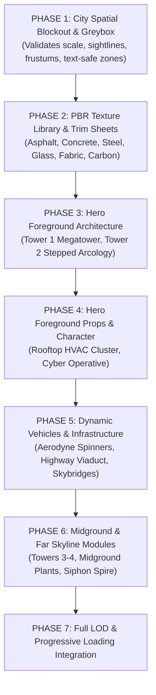

# PROJECT NIGHT CITY V4.0 — ASSET PRODUCTION BACKLOG & VALIDATION STANDARDS

**Production Stage:** Phase 1 (Task 3 / Steps 21, 22, 24)  
**Role:** Senior Environment Modeler & Technical Artist  
**Status:** FULLY ARCHITECTED & APPROVED  

---

## 1. Asset Production Dependency Graph

To prevent integration bottlenecks, 3D asset development is sequenced in logical dependency order:

---

## 2. Exhaustive Asset Production Specifications & Triangle Budgets

Rather than applying a generic flat budget, polygon allocations are proportional to camera proximity and visual prominence:

| Asset Task ID | Asset Name | Role / Placement | High LOD (Triangles) | Mid LOD (Triangles) | Low LOD (Triangles) | Material Slots | UV Strategy | Target File Size (GLB) |
| :--- | :--- | :---: | :---: | :---: | :---: | :---: | :---: | :---: |
| **`TASK_A01`** | **Corporate Megatower** (`TOWER_01`) | Hero Midground (15–45m) | `12,000 – 18,000` | `2,400` | `120` | 4 | Architectural Trim Sheet | `< 450 KB` |
| **`TASK_A02`** | **Secondary Arcology** (`TOWER_02`) | Hero Midground (20–50m) | `8,000 – 14,000` | `1,800` | `90` | 3 | Concrete Trim + UV Atlas | `< 350 KB` |
| **`TASK_A03`** | **Cyberpunk Operative** | Hero Focal Foreground (2–8m) | `10,000 – 16,000` | `3,200` | `N/A` | 5 | Bespoke Character UV Map | `< 380 KB` |
| **`TASK_A04`** | **Aerodyne Patrol Spinner** | Dynamic Flight Corridor (15–60m)| `6,000 – 9,000` | `1,500` | `140` | 4 | Vehicle UV Atlas | `< 250 KB` |
| **`TASK_A05`** | **Rooftop Machinery Cluster** | Foreground Terrace (4–12m) | `4,500 – 7,500` | `850` | `48` | 3 | Shared Rooftop Atlas | `< 180 KB` |
| **`TASK_A06`** | **Hexagonal Spire** (`TOWER_03`) | Midground Canyon (30–60m) | `2,500 – 4,000` | `600` | `48` | 2 | Cylinder UV + LED Torus | `< 120 KB` |
| **`TASK_A07`** | **Slanted Wedge Tower** (`TOWER_04`)| Midground Right Flank (35–65m) | `2,500 – 4,000` | `600` | `48` | 2 | Facade Trim Sheet | `< 120 KB` |
| **`TASK_A08`** | **Siphon Megatower** (`SKY_01`) | Far Skyline Center (70–140m) | `1,800 – 3,000` | `450` | `24` | 2 | Cylindrical / Cone UV | `< 80 KB` |
| **`TASK_A09`** | **Twin Needle Spires** (`SKY_03A/B`)| Far Skyline Right (70–140m) | `1,500 – 2,500` | `350` | `24` | 2 | Shared Spire Material | `< 80 KB` |
| **`TASK_A10`** | **Lower Highway Viaduct** | Canyon Depth (40–60m) | `3,000 – 5,000` | `800` | `N/A` | 2 | Continuous Roadbed UV | `< 150 KB` |
| **`TASK_A11`** | **Skybridge Connectors** | Midground Interconnects (30–50m)| `2,000 – 3,500` | `400` | `N/A` | 2 | Structural Steel Trim | `< 90 KB` |

---

## 3. Mandatory Asset Validation Standards

Before any asset is merged into production, it must pass a standardized 6-point visual and technical verification protocol:

1. **Front View (Neutral 3-Point Studio):** Confirms symmetrical balance, horizon alignment, and vertical scaling.
2. **Side View (Neutral 3-Point Studio):** Verifies depth profile, foundation base contact, and silhouette proportions.
3. **Three-Quarter Perspective View:** Demonstrates spatial dimensionality, beveled corner highlights, and surface form.
4. **Wireframe Overlay:** Validates clean quad-dominant topology, absence of degenerate zero-area faces, absence of non-manifold edges, and sensible edge-flow along chamfers.
5. **Neutral Studio Material Close-up:** Confirms correct PBR roughness scatter, metallic reflectivity, and tangent normal orientation.
6. **In-Scene Lighting Integration Render:** Confirms scale compatibility with the hero camera, absence of geometry clipping, and harmonious color integration with ambient city fog.

---

## 4. Re-Import & Cleanliness Checks
* All models must re-import cleanly via standard Three.js `GLTFLoader` with 0 console warnings.
* Pivots must be placed at the true foundation base (`min.y = 0.0`) so that placement transforms at `Y = targetY` require zero hardcoded guessing offsets.
