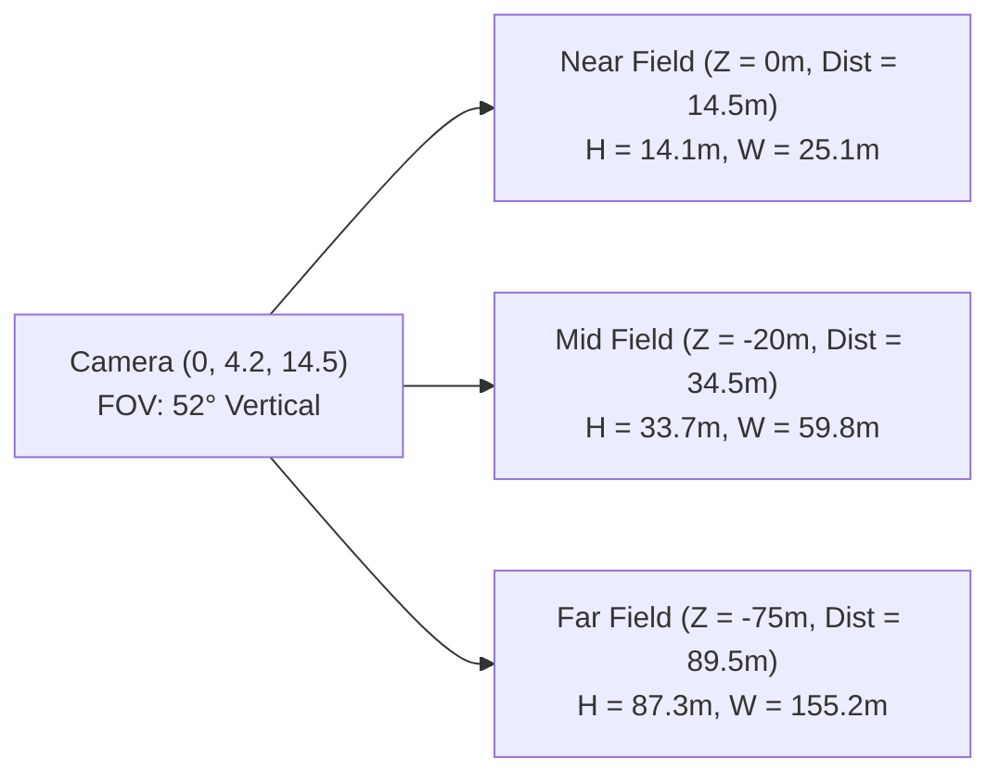

# PROJECT NIGHT CITY V4.0 — CAMERA COMPOSITION & CINEMATIC SCROLL PLAN

**Production Stage:** Phase 1 (Task 3 / Steps 16, 17, 18)  
**Role:** Cinematic Composition Artist & Camera Director  
**Status:** FULLY ARCHITECTED & APPROVED  

---

## 1. Camera Frustum & Mathematical Optics Audit

The primary camera utilizes a 52° vertical Field of View (FOV) rendering to a 16:9 aspect ratio display:



### Optical Calculations
* **Vertical Span at Distance $D$:** $H = 2 \cdot D \cdot \tan(26^\circ) \approx 0.9755 \cdot D$
* **Horizontal Span at Aspect 16:9 ($1.778$):** $W = H \cdot 1.778 \approx 1.734 \cdot D$
* **Near Field ($D = 14.5\text{m}$, Terrace Parapet):** $H = 14.1\text{m}$, $W = 25.1\text{m}$. Visible X range: $[-12.55\text{m}, +12.55\text{m}]$. Visible Y range: $[-2.8\text{m}, +11.3\text{m}]$.
* **Mid Field ($D = 34.5\text{m}$, Towers 1 & 2):** $H = 33.7\text{m}$, $W = 59.8\text{m}$. Visible X range: $[-29.9\text{m}, +29.9\text{m}]$. Tower 1 sits at $X = 14.5\text{m}$ (well within the right frame), Tower 2 sits at $X = -16.5\text{m}$ (well within the left frame).
* **Far Field ($D = 89.5\text{m}$, Skyline Spires):** $H = 87.3\text{m}$, $W = 155.2\text{m}$. Spans the entire background, enabling landmarks up to $Y = 88.0\text{m}$ to be framed.

---

## 2. Normalized Viewport Text-Safe Zoning

To ensure zero collision between 3D scene elements and critical DOM UI typography, the 1440 × 900 desktop hero viewport is partitioned into strict normalized coordinate zones:

```text
+-------------------------------------------------------------------------------+
| (0.0, 0.0)                                                         (1.0, 0.0) |
|   [ZONE A: TOP HUD & GLOBAL NAVIGATION]                                       |
|   y: 0.00 to 0.10 | x: 0.05 to 0.95 | Clean contrast against upper dark sky   |
+-------------------------------------------------------------------------------+
|                                       |                                       |
|   [ZONE B: HERO IDENTITY & HEADING]   |   [ZONE E: CITY ARCHITECTURAL FOCUS]  |
|   y: 0.18 to 0.45 | x: 0.06 to 0.46   |   y: 0.12 to 0.75 | x: 0.50 to 0.96   |
|   - "OM VYAS_" Heading                |   - Tower 1 Corporate Facade          |
|   - Subtitle: "FOUNDER // AI..."      |   - Recessed Windows & Spandrels      |
|   - Zero intersecting billboards/light|   - Penthouse Antenna & Skybridge     |
|                                       |                                       |
|   [ZONE C: HERO CTAs & METRICS HUD]   |                                       |
|   y: 0.46 to 0.65 | x: 0.06 to 0.46   |                                       |
|   - [INITIALIZE PROTOCOL] [RESUME]    |                                       |
|   - 3 Major Competitive Honors        |                                       |
|                                       |                                       |
+---------------------------------------+---------------------------------------+
|   [ZONE D: HERO CHARACTER & TERRACE]  |   [ZONE F: REFLECTIVE PUDDLE POOLS]   |
|   y: 0.62 to 0.92 | x: 0.22 to 0.42   |   y: 0.68 to 0.96 | x: 0.48 to 0.88   |
|   - Operative Seated Silhouette       |   - Specular Neon Light Pillars       |
+-------------------------------------------------------------------------------+
| (0.0, 1.0)                                                         (1.0, 1.0) |
+-------------------------------------------------------------------------------+
```

---

## 3. Six Cinematic Chapter Waypoints

The portfolio's continuous scroll smoothly interpolates camera position and look-at target across six distinct architectural chapters:

| Chapter | Section Target | Camera Position (X, Y, Z) | Look-At Target (X, Y, Z) | FOV | Visible Architectural Focus |
| :---: | :--- | :---: | :---: | :---: | :--- |
| **01** | **Hero Establishing** | `(0.0, 4.2, 14.5)` | `(0.0, 1.8, -20.0)` | `52°` | Wide canyon perspective, hero operative, Tower 1 framing right, distant skyline spires |
| **02** | **Operator Dossier** | `(-1.8, 3.2, 10.5)` | `(-2.0, 1.6, -15.0)` | `50°` | Reframes closer to operative on terrace; dossier panel slides in over left canyon void |
| **03** | **Fixer Contracts** | `(1.2, 2.2, 7.0)` | `(0.0, 1.2, -22.0)` | `48°` | Camera descends into the midground; Tower 1 billboard and canyon viaduct become prominent |
| **04** | **Cyberdeck Skills** | `(-0.8, 1.6, 4.2)` | `(0.0, 1.0, -25.0)` | `46°` | Low-altitude urban perspective; ambient lighting dims to prioritize interactive skill matrix |
| **05** | **Neural Research** | `(1.8, 1.4, 3.2)` | `(0.0, 1.2, -28.0)` | `46°` | Rightward vantage focusing on deep canyon transit infrastructure and skybridges |
| **06** | **Net Connect Finale** | `(0.0, 1.0, 2.2)` | `(0.0, 1.4, -30.0)` | `48°` | Low dramatic angle framing the entire illuminated skyline above the terminal footer |
