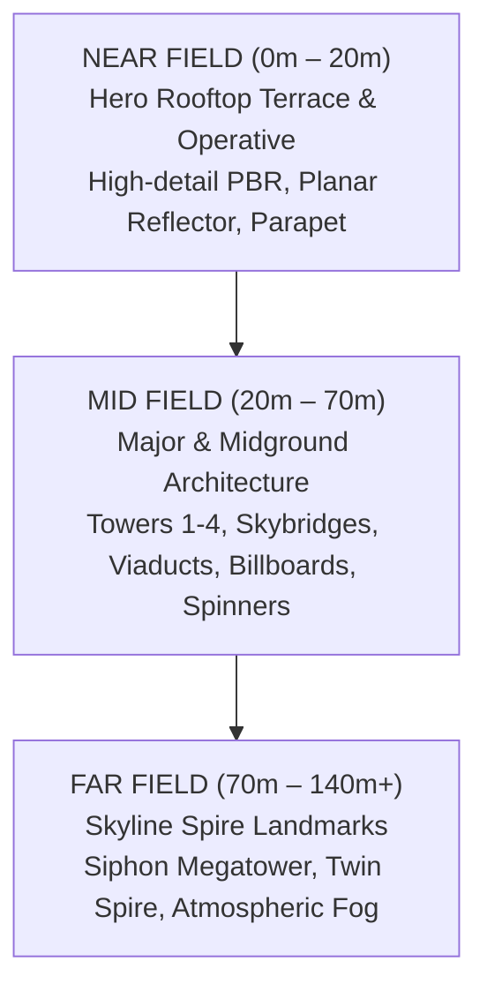

# PROJECT NIGHT CITY V4.0 — CITY SPATIAL LAYOUT & TOP-DOWN FOOTPRINT

**Production Stage:** Phase 1 (Task 3 / Steps 10, 11, 12)  
**Role:** Senior Level Designer & Spatial Architect  
**Status:** FULLY ARCHITECTED & APPROVED  

---

## 1. Top-Down Urban Canyon Spatial Plan

Night City is organized as a deep urban canyon expanding southward (+Z) from the distant megatowers (-Z) toward the foreground hero rooftop:

```text
========================================================================================================
                                     DEEP SKYLINE (Z = -70m to -120m)
                     [SL_02: Heavy Arcology]          [SL_01: Siphon Megatower]          [SL_03: Twin Spire]
                     (-24.0, 36.0, -85.0)              (0.0, 48.0, -78.0)                (20.5, 38.0, -78.0)
                                                (Peak Y = 88m)
========================================================================================================
                                     MIDGROUND CANYON (Z = -25m to -70m)
  [MW_02: Transit Spire]               [MW_01: Comm Screen Tower]                 [MW_03: Industrial Plant]
  (-28.0, 22.0, -48.0)                 (-9.0, 24.0, -38.0)                        (26.0, 18.0, -45.0)

               === SKYBRIDGE_02 ===                      === SKYBRIDGE_01 ===
               From T2 to MW_02                          From T1 to MW_03
               (-22.0, 28.0, -32.0)                      (18.5, 32.0, -28.0)

========================================================================================================
                                   FOREGROUND / MIDGROUND (Z = -10m to -25m)
     [TOWER 2: Stepped Arcology]                                             [TOWER 1: Corporate Megatower]
         (-16.5, 20.0, -20.0)                                                    (14.5, 17.2, -16.0)
         Width: 13m, Depth: 13m                                                  Width: 11.4m, Depth: 11.4m
         Height: 48m                                                             Height: 42.4m

                          <<< AERIAL FLIGHT CORRIDOR 01 (Y = 12.0m, Z = -14.0m) >>>
                          <<< LOWER CANYON HIGHWAY VIADUCT (Y = -5.5m, Z = -46.0m) >>>
========================================================================================================
                                      HERO ROOFTOP (Z = 0m to +10m)
       [Machinery Cluster]                   [Hero Character]                   [Parapet Hazard Coping]
       (-6.5, 2.4, 4.5)                      (-3.4, 0.7, 0.4)                   (0.0, 0.25, -2.55)
       HVAC, Fan, Conduits                   Netrunner Operative                Yellow Caution Stripes

                     [Localized Puddle Pool 01]             [Localized Puddle Pool 02]
                     (x: -2.0 to +1.0, z: 2.0 to 5.0)       (x: +2.0 to +5.5, z: 3.5 to 6.5)
========================================================================================================
                                      CAMERA VANTAGE (Z = +14.5m)
                                         Camera (0.0, 4.2, 14.5)
                                         Look-At Target (0.0, 1.8, -20.0)
========================================================================================================
```

---

## 2. Three Spatial Tiers Architecture



### A. Near Field (0 to 20m)
* **Depth Scope:** $Z \in [-2.55\text{m}, +10.0\text{m}]$.
* **Key Assets:** Hero netrunner operative, modular rooftop platform, perimeter parapet wall with beveled coping, yellow hazard stripes, localized organic puddle pools, industrial HVAC compressor cluster, rotating cooling fan, conduit pipe runs, electrical junction cabinet, and rising steam vents.
* **Lighting:** Warm yellow practical fill (`#FCEE0A`), direct specular key light (`#FFF5E6`), cyan rim edge (`#00E5FF`).
* **Material Goal:** Tactile, rain-slicked micro-surfaces with razor-sharp puddle reflections.

### B. Mid Field (20 to 70m)
* **Depth Scope:** $Z \in [-70.0\text{m}, -20.0\text{m}]$.
* **Key Assets:** Tower 1 (Corporate Skyscraper), Tower 2 (Secondary Stepped Arcology), Tower 3 (Hexagonal Media Spire), Tower 4 (Slanted High-Rise), Commercial Screen Tower, Midground Industrial Plant, Skybridge Connectors, Lower Canyon Highway Viaduct, and Aerodyne Tactical Spinners.
* **Lighting:** Neon billboard illumination, animated multi-lane vehicle light trails, window instancing matrices.
* **Material Goal:** Architectural structural depth, physical corner columns, recessed spandrel reveals.

### C. Far Field (70m onwards)
* **Depth Scope:** $Z \in [-140.0\text{m}, -70.0\text{m}]$.
* **Key Assets:** Siphon Megatower (central pinnacle rising to $Y = 88.0\text{m}$), Left Heavy Industrial Arcology Block, Right Twin Needle Spire Complex connected by high-altitude skybridge.
* **Lighting:** Asynchronous aviation strobe hazard beacons (`#FF0033`, 1.2 Hz), crown illuminated torus rings, atmospheric silhouette backlighting.
* **Material Goal:** Low-albedo silhouettes fading into deep atmospheric cyan/indigo haze, eliminating empty black negative voids.

---

## 3. Skyline Silhouette Planning

To guarantee that the metropolis reads as a living city even when all neon signs and billboards are turned off:
1. **Vertical Asymmetry:** The tallest landmark (Siphon Megatower, $Y = 88\text{m}$) anchors the center-left skyline, balanced by the Twin Needle Spires ($Y = 74\text{m}$) on the right.
2. **Stepped Rhythm:** Heights cascade downward from 88m to 48m (Tower 2) and 42.4m (Tower 1), preventing a flat uniform roofline.
3. **Connecting Bridges:** Horizontal and diagonal skybridges break the purely vertical lines and visually tie separate towers into an interconnected megalopolis.
