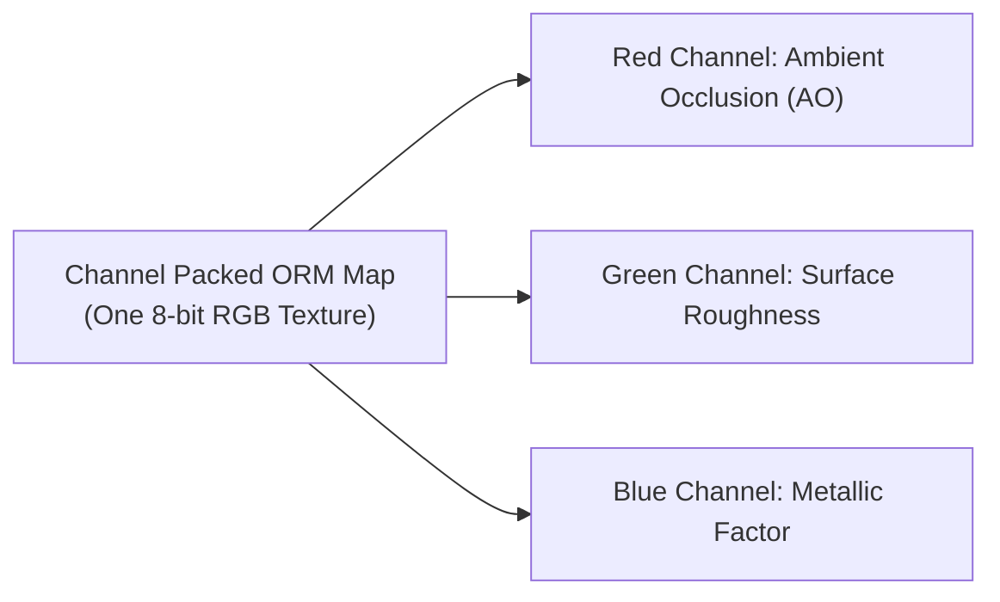

# PROJECT NIGHT CITY V4.0 — PBR MATERIAL LIBRARY SPECIFICATION

**Production Stage:** Phase 1 (Task 2 & 3 / Steps 4 & 23)  
**Role:** Senior PBR Materials Artist & Shading Technical Director  
**Status:** FULLY SPECIFIED & APPROVED  

---

## 1. Shading Pipeline & Packed ORM Texture Architecture

Night City V4.0 adopts the industry-standard glTF metallic-roughness PBR workflow utilizing packed ORM (Occlusion, Roughness, Metallic) texture channels to reduce texture sampler overhead and GPU memory bandwidth:

* **Color Space Encoding:**
  * Base Color / Albedo: sRGB (gamma corrected).
  * Normal Map (Tangent Space): Linear.
  * ORM Map (R: AO, G: Roughness, B: Metallic): Linear.
  * Emissive Map: sRGB.

---

## 2. Exhaustive 14-Material Specifications

### Material 01: `M_Asphalt_Wet` (Hero Terrace Floor)
* **Base Color:** Deep wet charcoal (`#14171C`), fine aggregate stone flecks.
* **Roughness:** Dynamic gradient. Centers of puddles: `0.04`; surrounding damp gravel: `0.78`–`0.88`.
* **Metalness:** `0.08` (Non-metallic dielectric).
* **Normal Detail:** High-frequency crushed stone aggregate micro-relief + concentric raindrop ripple ring distortion.
* **Ambient Occlusion:** Crevices between gravel stones darkened to `0.35`.
* **Emissive:** `0.0` (Zero self-illumination; purely reflective).
* **Texture Scale / Resolution:** 2048 × 2048 (2K), tileable at 4m × 4m world scale.

### Material 02: `M_Asphalt_Dry` (Elevated Roadways)
* **Base Color:** Medium asphalt gray (`#2A2F38`), oxidized traffic wear lanes.
* **Roughness:** Uniform high roughness (`0.82`–`0.92`).
* **Metalness:** `0.02`.
* **Normal Detail:** Directional tire scuffs, micro-porous surface.
* **Texture Scale / Resolution:** 1024 × 1024 (1K).

### Material 03: `M_Concrete_Aggregate` (Arcology Balconies & Pillars)
* **Base Color:** Cold architectural gray (`#3A414D`), exposed aggregate stones.
* **Roughness:** `0.75` (Matte, non-directional).
* **Metalness:** `0.10`.
* **Normal Detail:** Formwork board-marked seams, surface air bubbles, aggregate grain.
* **Texture Scale / Resolution:** 1024 × 1024 (1K).

### Material 04: `M_Concrete_Weathered` (Lower Canyon Retaining Walls)
* **Base Color:** Dark stained concrete (`#1F242C`) with vertical rain runoff streaks.
* **Roughness:** `0.65` (Streaks have lower roughness `0.45` to simulate damp moisture).
* **Metalness:** `0.05`.
* **Texture Scale / Resolution:** 1024 × 1024 (1K).

### Material 05: `M_Steel_Brushed` (Structural Columns & Skybridge Trusses)
* **Base Color:** Neutral industrial steel (`#475569`).
* **Roughness:** `0.22` (High anisotropic specularity).
* **Metalness:** `0.92` (High-grade conductor).
* **Normal Detail:** Horizontal machining/milling brush lines, rivet borders.
* **Texture Scale / Resolution:** 1024 × 1024 (1K).

### Material 06: `M_Steel_Painted` (HVAC Enclosures & Junction Boxes)
* **Base Color:** Dark tactical navy-gray (`#1E293B`) or hazard warning yellow (`#FCEE0A`).
* **Roughness:** `0.38` (Semi-gloss industrial powder coating).
* **Metalness:** `0.70` (Metal substrate under protective paint).
* **Texture Scale / Resolution:** 1024 × 1024 (1K, shared rooftop atlas).

### Material 07: `M_Titanium_Composite` (Aerodyne Fuselage)
* **Base Color:** Dark obsidian titanium (`#10141D`).
* **Roughness:** `0.18` (Sleek aerodynamic sheen).
* **Metalness:** `0.88`.
* **Normal Detail:** Precision panel seam recesses (2mm), hex fastener heads.
* **Texture Scale / Resolution:** 2048 × 2048 (2K).

### Material 08: `M_Architectural_Glass` (Curtain Wall Facades)
* **Base Color:** Deep cyan-tinted solar glass (`#0A1E2B`), transmission opacity: `0.82`.
* **Roughness:** `0.04` (Pristine mirror-like specular response).
* **Metalness:** `0.95`.
* **Normal Detail:** Subtle planar waviness to prevent perfectly flat CGI reflections.
* **Texture Scale / Resolution:** Procedural PBR shader.

### Material 09: `M_Ballistic_Fabric_Yellow` (Operative Techwear Jacket)
* **Base Color:** High-visibility signal yellow (`#F5CE13`).
* **Roughness:** `0.48` (Diffuse fabric scatter, zero metallic shine).
* **Metalness:** `0.00` (Pure dielectric).
* **Normal Detail:** Ripstop crosshatch ballistic weave, stitched seam ridges.
* **Texture Scale / Resolution:** 2048 × 2048 (2K).

### Material 10: `M_Carbon_Composite` (Operative Armor & Blade Scabbard)
* **Base Color:** Woven carbon black (`#0D0F14`).
* **Roughness:** `0.28`.
* **Metalness:** `0.45` (Resin-coated carbon fiber weave).
* **Normal Detail:** 2×2 twill carbon weave normal texture.
* **Texture Scale / Resolution:** 1024 × 1024 (1K).

### Material 11: `M_Tactical_Rubber` (Boots & Harness Webbing)
* **Base Color:** Matte vulcanized black (`#121316`).
* **Roughness:** `0.72`.
* **Metalness:** `0.05`.
* **Texture Scale / Resolution:** 512 × 512 (Shared atlas).

### Material 12: `M_Weathered_Plastic` (Conduits & Terminal Trims)
* **Base Color:** Slate industrial polymer (`#334155`).
* **Roughness:** `0.42`.
* **Metalness:** `0.12`.
* **Texture Scale / Resolution:** 512 × 512.

### Material 13: `M_Emissive_Signage` (Billboards & Neon Glyph Channels)
* **Base Color:** Full-spectrum RGB billboard artwork.
* **Roughness:** `0.90`.
* **Metalness:** `0.00`.
* **Emissive:** Sampled from color map with multiplier `2.2` (triggers UnrealBloomPass).
* **Texture Scale / Resolution:** 512 × 512 or 512 × 256.

### Material 14: `M_Rain_Stained_Metal` (Flanged Conduit Pipes)
* **Base Color:** Oxidized galvanized steel (`#64748B`).
* **Roughness:** `0.30` (Damp pooling along underside of pipe runs).
* **Metalness:** `0.85`.
* **Normal Detail:** Ring couplings, flange bolt heads.
* **Texture Scale / Resolution:** 1024 × 1024 (Shared rooftop atlas).

---

## 3. Texture Allocation & Budget Summary

| Asset Category | Target Resolution | Texture Maps | Estimated Transfer Size (Compressed) | Estimated VRAM Footprint |
| :--- | :---: | :---: | :---: | :---: |
| **Hero Operative** | 2048 × 2048 (2K) | Albedo, Normal, ORM | ~1.8 MB | ~16.0 MB |
| **Terrace Wet Asphalt**| 2048 × 2048 (2K) | Albedo, Normal, Roughness Mask | ~1.6 MB | ~16.0 MB |
| **Aerodyne Spinner** | 2048 × 2048 (2K) | Albedo, Normal, ORM, Emissive | ~1.9 MB | ~21.3 MB |
| **Corporate Skyscraper**| 1024 × 1024 (1K) | Trim Sheet (Albedo, Normal, ORM) | ~850 KB | ~5.3 MB |
| **Rooftop Machinery**| 1024 × 1024 (1K) | Shared Atlas (Albedo, Normal, ORM) | ~720 KB | ~5.3 MB |
| **Secondary Arcology** | 1024 × 1024 (1K) | Albedo, Normal | ~580 KB | ~4.0 MB |
| **Billboards & Decals** | 512 × 256 (Small) | Emissive Maps (7 textures) | ~420 KB | ~3.5 MB |
| **TOTALS** | — | — | **~7.87 MB** | **~71.4 MB** |
