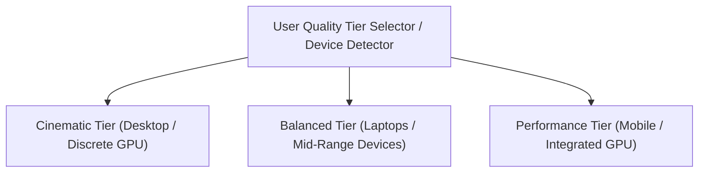

# PROJECT NIGHT CITY V4.0 — PERFORMANCE BUDGET & GRAPHICS TIERS

**Production Stage:** Phase 1 (Task 3 / Steps 25, 26, 27)  
**Role:** Senior WebGL Performance Engineer & Systems Architect  
**Status:** FULLY ARCHITECTED & APPROVED  

---

## 1. Multi-Tier Graphics Scalability Architecture

To ensure high visual fidelity on high-end GPUs while maintaining buttery 60 FPS performance on laptops and mobile devices, Project Night City V4.0 specifies three graphics quality tiers:

---

## 2. Exhaustive Per-Tier Performance Budgets

| Metric / Resource Dimension | Cinematic Tier (Target) | Balanced Tier (Target) | Performance Tier (Target) | Hard Failure Limit |
| :--- | :---: | :---: | :---: | :---: |
| **Target Frame Rate** | `60 FPS` stable | `60 FPS` stable | `60 FPS` / `30 FPS` mobile | `< 30 FPS` |
| **Average Frame Time** | `< 12.0 ms` | `< 10.0 ms` | `< 8.0 ms` | `> 33.3 ms` |
| **Maximum Draw Calls** | `< 180` | `< 110` | `< 65` | `> 250` |
| **Visible Scene Triangles** | `< 65,000` | `< 35,000` | `< 15,000` | `> 120,000` |
| **Device Pixel Ratio (DPR)** | `Math.min(devicePixelRatio, 2.0)` | `Math.min(devicePixelRatio, 1.5)` | `1.0` (Clamped) | `> 2.0` |
| **Planar Reflector Resolution**| `512 × 512` | `256 × 256` | **Disabled** (Simple roughness) | `> 1024 × 1024` |
| **UnrealBloomPass Quality** | Enabled (`radius=0.45, strength=0.75`)| Enabled (`radius=0.35, strength=0.55`)| **Disabled** (Direct WebGL) | Full-screen blurs |
| **Shadow Mapping** | PCFSoft (`2048 × 2048` key light) | PCF (`1024 × 1024` key light) | **Disabled** | `> 2048 × 2048` |
| **Shadow-Casting Lights** | `1` (Dominant Key Light) | `1` (Dominant Key Light) | `0` | `> 2` |
| **Instanced Rain Particles** | `3,800` streaks | `1,800` streaks | `600` streaks | `> 6,000` |
| **Steam Particle Emitters** | `140` soft particles | `70` soft particles | `30` soft particles | `> 300` |
| **Total GLB Asset Transfer** | `< 2.8 MB` total | `< 1.8 MB` total | `< 900 KB` total | `> 5.0 MB` |
| **GPU Texture VRAM Allocation**| `< 85 MB` | `< 45 MB` | `< 20 MB` | `> 150 MB` |
| **Reduced-Motion Mode** | Static frame (0 recurring rAF) | Static frame (0 recurring rAF) | Static frame (0 recurring rAF) | Recurring frames |

---

## 3. Instancing & Batching Directives

1. **Window Systems (`THREE.InstancedMesh`):**
   * Repeated office and residential windows across supporting midground towers are batched into a single `THREE.InstancedMesh` with an instance count of ~400–600 instances, consuming exactly **1 draw call** instead of 600 separate draw calls.
2. **Rain Particle Buffer (`THREE.LineSegments`):**
   * All 3,800 rain streaks share a single continuous `BufferGeometry` updated in-place via Float32Array indexing with `position.needsUpdate = true`. No geometry allocation or Garbage Collection churn occurs during runtime animation.
3. **Materials Sharing:**
   * Structural steel columns, conduit pipes, and skybridge trusses share `M_Steel_Brushed` and `M_Steel_Painted` instances rather than instantiating unique materials per mesh.
