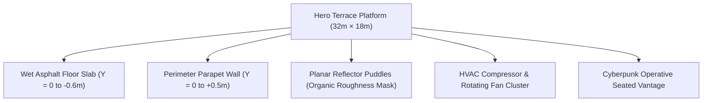

# PROJECT NIGHT CITY V4.0 — ROOFTOP DETAIL PLAN

**Production Stage:** Phase 1 (Task 3 / Step 15)  
**Role:** Senior Environment Modeler & Props Lead  
**Status:** FULLY ARCHITECTED & APPROVED  

---

## 1. Hero Rooftop Platform Anatomy

The rooftop serves as the primary visual anchor connecting the viewer and the developer portfolio to the sprawling metropolis below:



### Dimensional & Structural Specifications
* **Terrace Deck Dimensions:** `32.0m (Width) × 0.6m (Thickness) × 18.0m (Depth)`. Center at `(0, -0.6, 6.0)`.
* **Deck Surface Level:** `Y = 0.0m` (World Datum reference).
* **Parapet Wall:** Extends along the northern front edge (`Z = -2.55m`). Height: `0.5m`, Thickness: `0.9m`, Width: `32.0m`.
* **Coping Ledge:** Top edge beveled with 45° yellow and black hazard caution striping (`#FCEE0A` on `#0A0A0A`).

---

## 2. Organic Puddle Pools & Planar Reflector Layout

Rather than covering the entire terrace with a generic mirror, standing rainwater is concentrated into two distinct organic pools with Fresnel roughness transitions:

```text
========================================================================================
[TERRACE PARAPET EDGE: Z = -2.55m]
========================================================================================

                 [PUDDLE POOL 01: Main Reflective Basin]
                 Center: X = 2.0m, Z = 5.2m
                 Dimensions: 16.0m × 9.0m
                 Reflector Texture: 512 × 512 (Cinematic) / 256 × 256 (Balanced)
                 Reflection Color: 0x556677 (Subtle cool sky tint)
                 Water Center Roughness: 0.04 (Mirror specular)
                 Edge Roughness Falloff: 0.88 (Rough damp gravel aggregate)

  [PUDDLE POOL 02: Secondary Drainage Basin]
  Center: X = -5.0m, Z = 7.5m
  Dimensions: 6.0m × 4.0m
  Water Center Roughness: 0.08

========================================================================================
```

---

## 3. Industrial Equipment & Utility Layout

| Prop / Equipment ID | Description | Exact Coordinates (X, Y, Z) | Dimensions (W × H × D) | Material Assignment | Functional Purpose |
| :--- | :--- | :---: | :---: | :--- | :--- |
| **`HVAC_MAIN`** | Primary Compressor Unit | `(-6.50, 0.90, 5.50)` | `2.40 × 1.80 × 2.00 m` | `M_Steel_Painted` (`#1E293B`) | Houses cooling compressor and vents |
| **`FAN_ASSEMBLY`**| Quad-Blade Industrial Fan | `(-6.50, 1.10, 6.52)` | `1.10 × 1.10 × 0.08 m` | `M_Alloy_Dark` (`#0F172A`) | Rotates continuously at `6.5 rad/s` |
| **`VENT_DUCT_01`**| Galvanized Sheet Metal Duct | `(-9.50, 0.70, 4.00)` | `1.60 × 1.40 × 8.00 m` | `M_Aluminium_Galvanized` | Feeds exhaust to rear building riser |
| **`STEAM_VENT`**  | Upward Thermal Steam Emitter| `(-6.50, 1.40, 5.50)` | Point particle volume | Soft alpha particle sprite | Emits warm atmospheric steam |
| **`PIPE_RUN_01`** | Flanged Steel Conduits (Triple)| `(-4.00, 0.25, 1.50)` | `0.16 × 0.16 × 12.00 m` | `M_Steel_Brushed` (`#64748B`) | High-pressure coolant transmission |
| **`BREAKER_01`**  | High-Voltage Junction Cabinet | `(-8.20, 0.75, 2.00)` | `0.80 × 1.50 × 0.50 m` | `M_Steel_Painted` + Hazard Trim| Powers rooftop communications array |
| **`FLOOR_GRATE`** | Cast Iron Drainage Grate | `(0.00, 0.01, 2.00)` | `1.20 × 0.02 × 1.20 m` | `M_Cast_Iron` | Directs runoff away from walkway |

---

## 4. Character Seating Contact Point & Silhouetting

* **Operative World Position:** `(-3.40, 0.00, 0.40)`.
* **Seating Ledge Alignment:** Operative sits directly on the rear deck edge facing northeast toward the city canyon (Rotation Y: `28°`).
* **Ground Contact:** Boots rest flat on the asphalt surface at `Y = 0.0m`.
* **Silhouette Readability:** Backlit by the cyan rim light of Tower 1 and reflections from the canyon below; signal-yellow jacket (`#F5CE13`) creates an unmistakable human presence without interfering with DOM portfolio text.
