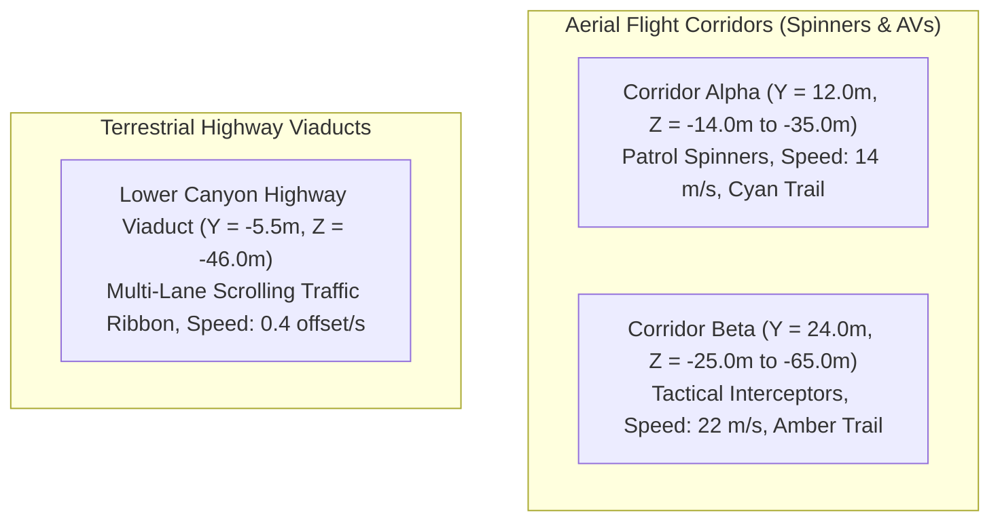

# PROJECT NIGHT CITY V4.0 — TRAFFIC & BILLBOARD MASTER PLAN

**Production Stage:** Phase 1 (Task 3 / Steps 13 & 14)  
**Role:** Level Designer, VFX Artist & Motion Lead  
**Status:** FULLY ARCHITECTED & APPROVED  

---

## 1. Transportation Corridors & Dynamic Traffic

Night City features two distinct transportation systems: terrestrial/elevated vehicular traffic and 3D aerial flight corridors:

### Motion & Safety Directives
1. **Z-Range Reset:** Vehicles travel southward along `-Z` toward `+Z`. Upon crossing `Z = 2.0m`, their position wraps seamlessly to `Z = -38.0m` with randomized horizontal offsets ($X \in [8.0m, 16.0m]$).
2. **Text-Safe Flight Envelope:** All vehicle flight paths are strictly restricted to $X \ge +6.0\text{m}$ (right side of the canyon). Zero vehicles or light-trail ribbons ever cross the hero identity zone ($X \in [-12.0\text{m}, +4.0\text{m}]$).
3. **Delta-Time Movement:** All positions update via `position.z += speed * delta`, guaranteeing 100% frame-rate-independent physics whether running at 30 FPS, 60 FPS, or 120 FPS.

---

## 2. Master Billboard & Media Display Registry

To ensure every glowing display is grounded in realistic urban architecture, billboards must be physically mounted to tower frameworks rather than floating in space:

| Billboard ID | Host Structure | World Position (X, Y, Z) | Dimensions (W × H) | Facing Angle | Brand / Graphical Identity | Emissive Intensity | Animation Type | Text-Safe Compliance |
| :--- | :---: | :---: | :---: | :---: | :--- | :---: | :---: | :---: |
| **`BB_01`** | `TOWER_01` Facade | `(9.00, 24.00, -15.80)` | `7.00 × 5.00 m` | `0°` (South) | **`NEURON // DYNAMICS`** (Brain network topology) | `2.2` | Subtle node pulse | Right half only ($x > 5.5$) |
| **`BB_02`** | `TOWER_01` Low | `(9.00, 11.00, -15.80)` | `6.00 × 3.20 m` | `0°` (South) | **`DEEP_NET // RESEARCH`** (Telemetry wave) | `1.8` | Static with glow | Right half only ($x > 6.0$) |
| **`BB_03`** | `TOWER_02` Terrace| `(-10.50, 22.00, -19.80)` | `4.50 × 8.00 m` | `15°` (SE) | **`SECTOR 04 // ARCOLOGY`** (Brutalist Kanji) | `1.6` | Scanline cycle | Far left ($x < -8.0$) |
| **`BB_04`** | `MW_01` Crown | `(-4.50, 36.00, -47.80)` | `10.00 × 4.50 m` | `0°` (South) | **`PORTFOLIO_OS // KERNEL`** (System status) | `2.0` | Digital ticker | Distant canyon ($z = -48$) |
| **`BB_05`** | Viaduct Gantry | `(18.00, -3.80, -45.80)` | `12.00 × 1.80 m` | `0°` (South) | **`CANYON TRANSIT // METRO`** (Wayfinding) | `1.5` | Scrolling arrows | Deep canyon level ($y = -3.8$) |
| **`BB_06`** | Left Scaffolding | `(-24.00, 18.00, -20.00)` | `3.20 × 14.00 m`| `25°` (SE) | **`CYBERDECK // ARCHIVE`** (Vertical neon) | `2.4` | Neon flicker | Far left outside hero text |

> [!IMPORTANT]
> **Defect Prevention Rule:** Billboard `BB_06` was relocated to $X = -24.0\text{m}$ in V2.2 and is permanently locked to that coordinate to guarantee it never re-enters the hero text-safe zone.
