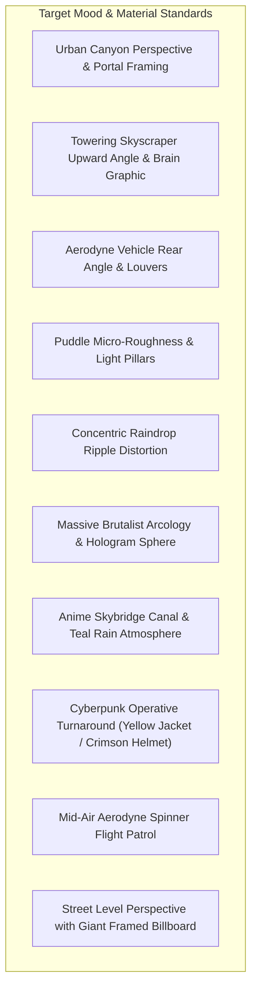

# PROJECT NIGHT CITY V4.0 — VISUAL REFERENCE BOARD

**Production Stage:** Phase 1 (Task 2)  
**Role:** Senior Concept Artist & Art Director  
**Status:** REFERENCE ARCHIVE CATALOGED  

---

## 1. Aesthetic Reference Analysis

The following visual references provided by the user establish the quality benchmarks, atmospheric mood, and material characteristics for Night City V4.0:

### Detailed Reference Breakdown

1. **Urban Canyon Alleyway & Framing (Ref Image 1):**
   * *Visual Elements:* Deep vertical perspective framed by dark industrial facades on both sides. High architectural density with vertical Japanese neon signs ("BAR", "HOTEL", noodles), instanced lit windows, and dark metallic wall panels.
   * *Art Direction Translation:* Used to establish the primary camera canyon view looking forward from the hero rooftop.

2. **Upward Skyscraper Angle & Brain Logo (Ref Image 2):**
   * *Visual Elements:* Dramatic low-angle perspective looking up at soaring corporate towers against a crisp night sky. Large facade-projected neural net / brain hologram graphic.
   * *Art Direction Translation:* Direct inspiration for Tower 1 (`NEURON // DYNAMICS`), incorporating structural corner columns and a holographic network billboard.

3. **Futuristic Tactical Vehicle (Ref Image 3):**
   * *Visual Elements:* Aggressive rear styling, aerodynamic louvers, horizontal red LED lightbar, iridescent purple/cyan/blue painted chassis, dual ducted hover turbines underneath with cyan glow.
   * *Art Direction Translation:* Groundwork for `aerodyne_spinner.glb` hull, swept wing geometry, and ducted turbine nacelles.

4. **Wet Asphalt & Puddle Micro-Roughness (Ref Image 4):**
   * *Visual Elements:* High-frequency gravel aggregate bump, razor-sharp specular light reflections in standing water centers, Fresnel roughness falloff at puddle edges.
   * *Art Direction Translation:* Establishes the PBR texture target for `M_Asphalt_Wet` (replacing flat solid planes with gravel normal mapping and localized water roughness masks).

5. **Raindrop Ripple Distortions (Ref Image 5):**
   * *Visual Elements:* Concentric circular water ripple rings breaking up specular neon reflections (vivid red and cyan) on wet pavement.
   * *Art Direction Translation:* Requirement for rain droplet normal ripple maps on the terrace reflection plane.

6. **Massive Stepped Arcology & Hologram Sphere (Ref Image 6):**
   * *Visual Elements:* Multi-tiered stepped brutalist megastructure with glowing spherical hologram / globe atop the crown, illuminated skybridges connecting adjacent towers, and flying vehicles at varied altitudes.
   * *Art Direction Translation:* Blueprint for Tower 2 (Residential Arcology) and skybridge connections.

7. **Anime Cyberpunk Rain Street & Skybridge Canal (Ref Image 7):**
   * *Visual Elements:* Moody teal/cyan atmospheric fog, heavy rain streaks, elevated skybridge walkways with warm amber underglow, reflective street surface with blurred light trails.
   * *Art Direction Translation:* Inspires the color temperature contrast: cool cyan/teal fog background vs. warm amber practical lighting under walkways and bridges.

8. **Cyberpunk Operative Turnaround (Ref Image 8):**
   * *Visual Elements:* Original netrunner operative wearing a signal-yellow techwear jacket (`#F5CE13`), red diagonal chest harness with buckles, chiseled crimson netrunner helmet (`#DE1A35`) with horizontal visor, dark cargo pants with yellow straps, tactical boots, and back tech pack.
   * *Art Direction Translation:* Precise visual specification for `cyber_operative.glb` silhouette, clothing geometry, and color distribution.

9. **Aerodyne Spinner in Mid-Air Flight (Ref Image 9):**
   * *Visual Elements:* Flying vehicle banking through an urban canyon. Swept wings with wingtip canards, glowing cyan hover turbine wheels, orange trim lines, faceted cockpit canopy, dual plasma thrusters blasting cyan trails.
   * *Art Direction Translation:* Used for the vehicle flight path animation and light-trail ribbons in the midground canyon.

10. **Street-Level Perspective & Billboard Mounts (Ref Image 10):**
    * *Visual Elements:* Wide urban canyon, stepped commercial towers with illuminated window grids, massive cantilevered billboard with structural mounting trusses, distant skyscraper fading into upper haze.
    * *Art Direction Translation:* Informs the billboard placement rule: all media displays must be physically mounted to architectural trusses rather than floating detached in empty space.

---

> [!NOTE]
> All reference images are cataloged strictly as internal artistic benchmarks and inspiration for original 3D modeling and lighting design. No copyrighted third-party game assets or proprietary trademarks are incorporated into the production build.
