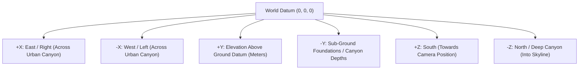

# PROJECT NIGHT CITY V4.0 — WORLD COORDINATE STANDARD & GLB PIVOT AUDIT

**Production Stage:** Phase 1 (Task 3 / Steps 8 & 9)  
**Role:** Three.js Spatial Architect & Technical Director  
**Status:** FULLY AUDITED & MATHEMATICALLY CERTIFIED  

---

## 1. World Coordinate System Definition

Night City uses a standard Three.js right-handed Cartesian coordinate system with explicit metric units:



### Core Conventions
* **Metric Scale:** `1.0 Three.js World Unit = 1.0 Real-World Metre`.
* **Ground Datum (`Y = 0.0`):** Defined as the street/ground level of the city canyon.
* **Hero Rooftop Terrace Datum (`Y = 0.0` relative to terrace group, placed at world height):** The operative and hero terrace surface sits at terrace deck elevation `Y = 0.0` with the slab extending down to `Y = -0.6m`.
* **Forward Axis:** `-Z` direction (facing into the city depth toward skyline spires).
* **Vertical Axis:** `+Y` (upward elevation into the atmosphere).

---

## 2. Mandatory Audit of Current GLB Pivots & Offsets

An automated binary parse of the GLB container vertex accessors revealed that all five V2.3.1 assets were exported with their bounding boxes centered around local `(0, 0, 0)`. When placed in the world at `Y = 0` without an internal offset, the bottom half of each model was submerged underground!

### Mathematical Asset Alignment Table

| Asset Name | Internal Bounding Min | Internal Bounding Max | Extents (W × H × D) | Internal Center Y | Foundation Base (Min Y) | Corrective Offset Required (`-min.y`) |
| :--- | :---: | :---: | :---: | :---: | :---: | :---: |
| **`corporate_skyscraper.glb`** | `[-5.70, -21.20, -5.70]` | `[5.70, 21.20, 5.70]` | `11.40 × 42.40 × 11.40 m` | `0.00 m` | `-21.20 m` | **`+21.20 m`** |
| **`secondary_arcology.glb`** | `[-6.50, -24.00, -6.50]` | `[6.50, 24.00, 6.50]` | `13.00 × 48.00 × 13.00 m` | `0.00 m` | `-24.00 m` | **`+24.00 m`** |
| **`rooftop_machinery.glb`** | `[-1.30, -2.40, -2.25]` | `[1.30, 2.40, 2.25]` | `2.60 × 4.80 × 4.50 m` | `0.00 m` | `-2.40 m` | **`+2.40 m`** |
| **`cyber_operative.glb`** | `[-0.38, -0.70, -0.38]` | `[0.38, 0.70, 0.38]` | `0.76 × 1.40 × 0.76 m` | `0.00 m` | `-0.70 m` | **`+0.70 m`** |
| **`aerodyne_spinner.glb`** | `[-1.91, -0.44, -1.70]` | `[1.91, 0.44, 1.70]` | `3.82 × 0.88 × 3.40 m` | `0.00 m` | `-0.44 m` | **`+0.44 m`** |

### Pivot Transformation Directives

1. **`corporate_skyscraper.glb`:**
   * *Problem:* Placing at `(14.5, 0, -16)` buried 21.2m of the tower under the city floor, meaning only the top 21.2m emerged.
   * *Correction:* To rest on ground datum `Y = 0` with a 4m subterranean foundation basement, the model node must be placed at local `Y = 17.2m` inside its placement group (`21.2m - 4.0m`).
2. **`secondary_arcology.glb`:**
   * *Problem:* Placing at `(-16.5, 0, -20)` buried 24.0m of the arcology under the ground.
   * *Correction:* Position node at local `Y = 20.0m` inside its placement group so its base securely anchors into the ground with 4m foundation overlap.
3. **`rooftop_machinery.glb`:**
   * *Problem:* Placing at `Y = 0` on the rooftop deck caused 2.4m of the HVAC compressor and conduits to penetrate through the roof slab.
   * *Correction:* Position node at local `Y = 2.4m` so the bottom mounting skids rest exactly on the rooftop surface (`Y = 0.0`).
4. **`cyber_operative.glb`:**
   * *Problem:* Internal center `(0, 0, 0)` placed the netrunner's waist at the origin and sank boots 0.7m into the ground.
   * *Correction:* Position node at local `Y = 0.7m` so the magnetic boot soles contact the rooftop pavement at `Y = 0.0`.
5. **`aerodyne_spinner.glb`:**
   * *Problem:* Center placed the middle of the canopy at world elevation; thrusters were at `-0.44m`.
   * *Correction:* In-flight positions treat origin as flight centroid; offset by `+0.44m` when landed.

---

## 3. World Coordinate Registry Standard

All assets in V4.0 must adhere to this standardized placement pattern:

```ts
// Standard Asset Container Pattern
const assetGroup = new THREE.Group();
assetGroup.position.set(worldX, worldY, worldZ);
assetGroup.rotation.y = rotationY;

// Inner node applies the corrective foundation offset
const modelNode = gltf.scene;
modelNode.position.set(0, baseOffset, 0);
assetGroup.add(modelNode);

scene.add(assetGroup);
```
